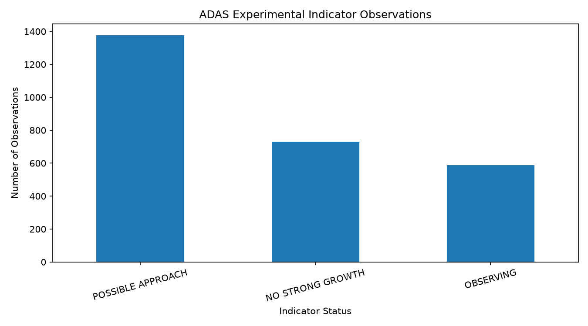
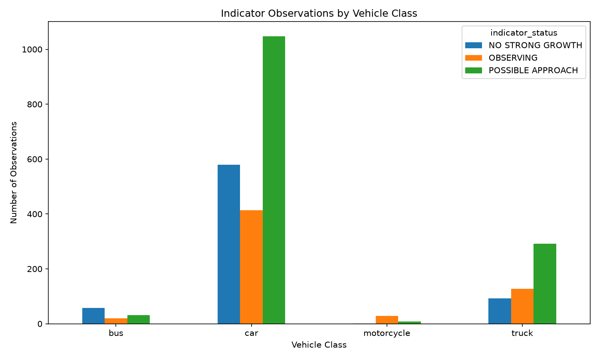

# ADAS Computer Vision & Collision Risk Estimation

🚀 **Live Demo:** [Launch ADAS App](https://adas-collision-risk-detection.streamlit.app)

💻 **Source Code:** [View on GitHub](https://github.com/sivaramakrishnavakati-cloud/adas-collision-risk-detection)

An AI-powered computer vision prototype that detects and tracks vehicles in driving videos and analyzes experimental bounding-box growth indicators.

> **Disclaimer:** This is a research prototype, not a validated collision-prediction or safety-certified ADAS system.


# ADAS Computer Vision and Collision Risk Indicator

## Overview

This project explores computer vision techniques used in Advanced Driver Assistance Systems (ADAS).

It uses YOLO object detection and multi-object tracking to identify vehicles in driving footage, follow their positions across video frames, and calculate an experimental approach indicator based on bounding-box area growth.

The project also records observations in CSV format and generates evaluation reports and visualizations.

## Features

- Vehicle detection using YOLO.
- Multi-object tracking using ByteTrack.
- Tracking IDs for detected vehicles.
- Bounding-box area analysis over time.
- Experimental approach indicator.
- CSV logging of vehicle observations.
- Evaluation reports using pandas.
- Charts showing indicator observations by vehicle class and status.

## Technologies

- Python
- Ultralytics YOLO
- OpenCV
- ByteTrack
- pandas
- Matplotlib

## Project Structure

```text
adas-collision-risk-detection/
├── collision_risk.py
├── track_vehicles.py
├── detect_objects.py
├── evaluate_results.py
├── visualize_results.py
├── requirements.txt
├── .gitignore
└── outputs/
    ├── approach_indicator_log.csv
    ├── evaluation_report.txt
    ├── indicator_status_chart.png
    └── vehicle_class_chart.png
```

## Results and Visualizations

The project generates visual reports to help analyze object tracking and the experimental approach indicator.

### Approach Indicator Status

This chart summarizes the number of observations assigned to each indicator status.



### Vehicle Class Analysis

This chart shows the distribution of indicator statuses across detected vehicle classes.



### Evaluation Summary

The evaluation script generates a report containing:
- Total recorded observations.
- Number of unique tracked object IDs.
- Vehicle class distribution.
- Indicator status distribution.
- Data quality checks.

See [`outputs/evaluation_report.txt`](outputs/evaluation_report.txt) for the detailed report.

---

## Installation and Usage

### Prerequisites

- Python 3.10 or a compatible version
- Git
- A short driving video for testing

### 1. Clone the Repository

```bash
git clone https://github.com/sivaramakrishnavakati-cloud/adas-collision-risk-detection.git
cd adas-collision-risk-detection
